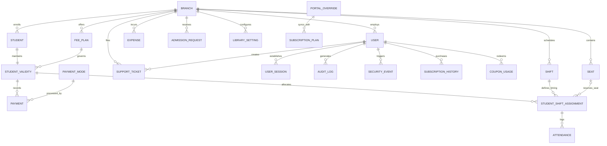

## 🌟 Key Highlights & System Overview

- **Multi-Tenant / Branch Architecture**: Clean isolation of branches, members, seats, shifts, fee plans, staff, and expenses.
- **Role-Based Access Control (RBAC)**: Support for `OWNER` and `STAFF` roles with dynamic URL prefix routing (`/:role/:name/dashboard`).
- **Comprehensive Device & Session Security**: Single-device concurrent session enforcement, failed login lockouts, and security audit logs.
- **SaaS Subscription & Payment Gateway**: Dynamic tier-based SaaS billing powered by **Razorpay**, promotional coupons, automated renewal queueing, and downloadable PDF invoices.
- **Shift & Seat Allocation Engine**: 10-column interactive seat layout, shift timing enforcement, and prevention of double-booking.
- **Dual Attendance Portals**: In-system staff check-in panel with a live "In-Library" monitor plus a standalone, fast Public Kiosk (`/public-attendance`) with auto-timeout.
- **Financial & Operational Management**: Instant cashier fee collection desk (`/collect-fee`), recurring validities, expense tracking, and revenue analytics.
- **Automated Test Suite**: Complete testing architecture with **Vitest** (Unit & Integration), **Supertest** (API), and **Playwright** (E2E browser tests).

---

## 🏗️ System Architecture

The application adopts a **Layered Controller-Service-Repository Pattern** that decouples HTTP handling, business calculations, database operations, and user workflows:

```
┌─────────────────────────────────────────────────────────────────────────────┐
│                            FRONTEND (React 19 + Vite)                       │
│                                                                             │
│   ┌───────────────┐ ┌───────────────┐ ┌───────────────┐ ┌───────────────┐   │
│   │   Dashboard   │ │   Admission   │ │ Member Portal │ │  Collect Fee  │   │
│   │  & Real-Time  │ │ (Staff / Pub) │ │  & Profiles   │ │ (Cashier Desk)│   │
│   └───────┬───────┘ └───────┬───────┘ └───────┬───────┘ └───────┬───────┘   │
│   ┌───────┴───────┐ ┌───────┴───────┐ ┌───────┴───────┐ ┌───────┴───────┐   │
│   │  Attendance   │ │ Seat / Shift  │ │   Expenses    │ │ Subscriptions │   │
│   │ (Staff/Kiosk) │ │  Allocation   │ │  & Analytics  │ │ & Invoicing   │   │
│   └───────────────┘ └───────────────┘ └───────────────┘ └───────────────┘   │
│                                     │ Axios Client (Auto Bearer + Device-Id)│
└─────────────────────────────────────┼───────────────────────────────────────┘
                                      │ HTTP / REST API (Port 3000)
┌─────────────────────────────────────┼───────────────────────────────────────┐
│                       BACKEND (Node.js + Express 5)                         │
│                                                                             │
│   ┌─────────────────────────────────────────────────────────────────────┐   │
│   │                     Security & Auth Middlewares                     │   │
│   │  • In-Memory IP Rate Limiter  • Device Session Validation (Single)  │   │
│   │  • JWT Auth & Lockout Guard   • Subscription Expiry Interceptor     │   │
│   └──────────────────────────────────┬──────────────────────────────────┘   │
│                                      │                                      │
│   ┌──────────────────────────────────┴──────────────────────────────────┐   │
│   │                       Controllers Layer (16 Files)                  │   │
│   │  Auth, Students, Seats, Shifts, Payments, Attendance, Support, etc. │   │
│   └──────────────────────────────────┬──────────────────────────────────┘   │
│                                      │ calls                                │
│   ┌──────────────────────────────────┴──────────────────────────────────┐   │
│   │                     Business Logic Layer (Services)                 │   │
│   │  • subscriptionPlan.service.js (Dynamic Tiers & Quota Limits)       │   │
│   │  • coupon.service.js           (Promo Validation & Discounts)       │   │
│   │  • subscriptionHistory.service.js (Payment Audit & Invoices)        │   │
│   └──────────────────────────────────┬──────────────────────────────────┘   │
│                                      │ queries                              │
│   ┌──────────────────────────────────┴──────────────────────────────────┐   │
│   │               Database Client / Adapter (mongoClient.js)            │   │
│   │  • Unified Prisma-Compatible Query API (findMany, create, upsert)   │   │
│   │  • Sequence Auto-Increment Counter Generator (Integer IDs)          │   │
│   │  • Relation Resolution & Nested Includes Engine                     │   │
│   └──────────────────────────────────┬──────────────────────────────────┘   │
│                                      │ Mongoose Models                      │
└──────────────────────────────────────┼──────────────────────────────────────┘
                                       │
┌──────────────────────────────────────┴──────────────────────────────────────┐
│                    DATABASE (MongoDB Atlas Cloud Cluster)                   │
│                                                                             │
│  [Branch] ──┬──< [Users] ───────< [UserSessions] & [AuditLogs]              │
│             ├──< [Students] ────< [StudentValidities] ──< [Payments]        │
│             │                          │                                    │
│             ├──< [Seats]               └──< [StudentShiftAssignments]       │
│             │                                       │                       │
│             ├──< [Shifts] ──────────────────────────┴──< [Attendance]       │
│             ├──< [FeePlans]                                                 │
│             ├──< [Expenses]                                                 │
│             ├──< [SupportTickets]                                           │
│             ├──< [SubscriptionPlans] & [PortalOverrides]                    │
│             └──< [SubscriptionHistories] & [CouponUsages]                   │
└─────────────────────────────────────────────────────────────────────────────┘
```

### Architectural Highlights

1. **Decoupled Business Services (`backend/src/services/`)**:
   - `subscriptionPlan.service.js`: Dynamically queries MongoDB Atlas (`portal_overrides` and `subscription_plans`) to compute real-time student limits, staff quotas, and device limits.
   - `coupon.service.js`: Handles coupon verification, one-time user consumption checks, and promotional tier validation.
   - `subscriptionHistory.service.js`: Manages the permanent audit trail of Razorpay subscription orders and invoices.
2. **Adapter / Repository Layer (`backend/src/config/mongoClient.js`)**:
   - Emulates Prisma-style client delegates (`findMany`, `findFirst`, `findUnique`, `create`, `update`, `upsert`, `count`, `aggregate`, `$transaction`).
   - Shields all 16 controllers from direct database coupling, making future database migrations or schema adjustments seamless.
3. **Multi-Tiered Automated Testing (`tests/`)**:
   - **Unit Tests**: Fast, isolated tests for frontend hooks/components and backend utilities/models via **Vitest**.
   - **Integration Tests**: Tests service quotas, rate limiters, and composite components.
   - **API Tests**: Express endpoint execution via **Supertest**.
   - **End-to-End (E2E) Tests**: Full browser userflow automation powered by **Playwright**.
   - **Sequential Runner**: Single-command execution (`npm test`) that runs all suites in order and outputs a consolidated status summary.

---

## 💻 Tech Stack

### Frontend
- **Framework**: [React 19](https://react.dev/) with [Vite](https://vitejs.dev/)
- **Routing**: [React Router DOM v7](https://reactrouter.com/) (Dynamic nested role routes)
- **Styling**: Vanilla CSS & Custom Design System (Dark/Light mode support via `ThemeContext`)
- **Icons**: [React Icons](https://react-icons.github.io/react-icons/) (FontAwesome)
- **Document Exporting**: [jspdf](https://github.com/parallax/jsPDF) & [html2canvas](https://html2canvas.hertzen.com/)
- **Scanner / Hardware Support**: [html5-qrcode](https://github.com/mebjas/html5-qrcode) & [qrcode](https://github.com/soldair/node-qrcode)
- **HTTP Client**: Axios with interceptors for automatic Bearer JWT and `X-Device-Id` injection

### Backend
- **Runtime**: [Node.js](https://nodejs.org/) & [Express 5](https://expressjs.com/)
- **ORM & Data Layer**: [Mongoose / MongoDB](https://mongoosejs.com/) (MongoDB Atlas Cloud Cluster)
- **Authentication**: JSON Web Tokens (JWT) + BCrypt password hashing
- **Security & Reliability**: In-memory IP rate limiting, active session verification, CORS whitelisting
- **Payment Processing**: [Razorpay Node SDK](https://razorpay.com/) for subscription checkouts & signature validation
- **Mailing**: [Resend](https://resend.com/) integration for transactional notifications
- **Deployment**: Serverless entrypoint configured for [Vercel](https://vercel.com/) via `api/index.js`

### Testing & Quality Assurance
- **Unit & Integration Runner**: [Vitest](https://vitest.dev/) with JSDOM environment
- **Component Testing**: [@testing-library/react](https://testing-library.com/) & [@testing-library/jest-dom](https://github.com/testing-library/jest-dom)
- **API Testing**: [Supertest](https://github.com/ladjs/supertest)
- **E2E & UI Testing**: [Playwright](https://playwright.dev/) with automated webServer launcher and slow-motion support

---

## 🚀 Core Features & Business Logic

### 1. Dynamic Authentication & Security
- **Role-Based Routing**: After login, users are routed to their personal role path: `/:role/:userName/dashboard` (e.g., `/owner/john-doe/dashboard` or `/staff/alex/dashboard`).
- **Single-Device Enforcement**: Each user session generates and verifies a unique `deviceId`. Logging in from a second browser/device logs out the previous session.
- **Brute Force Lockout**: Accounts lock automatically for a cooldown period after consecutive failed login attempts.
- **Mandatory First Login Password Change**: Owners flagged with `mustChangePassword` are constrained to `/change-password` before accessing operational pages.
- **Subscription Expiry Interceptor**: When a library subscription lapses, write operations (POST, PUT, DELETE) are blocked across all branch users, allowing only dashboard viewing and renewal actions.

### 2. Dashboard (`/:role/:name/dashboard`)
- **Live Metric Cards**: Total Members, Active Members, Occupied Reserved Seats, Suspended Students, Today's Attendance, and Expiring Soon (within 7 days).
- **Drilldown Modals**: Clicking any metric card opens a modal listing all matching students with direct links to profiles.
- **Interactive Seat Availability**: Live visualization of available vs. occupied seats across all active shifts.
- **Revenue Analytics**: Year-selectable bar chart comparing monthly collections.
- **Recent Payments Ledger**: Quick view of latest student fee payments.
- **Notification Center**: Bell icon showing urgent alerts (expiring memberships, new pending admission requests).

### 3. Admission & Registration (`/:role/:name/admission`)
- **Automated Identifiers**: Auto-generates student codes (e.g., `LI00001`) and monthly registration numbers (e.g., `20260900001`).
- **One-Shot Transactional Onboarding**:
  - Captures personal details (Photo, Name, Gender, Mobile, Email, DOB, Aadhaar, Address).
  - Selects Fee Plan (duration, fee, registration fee) and study shift.
  - Chooses Access Type: **Reserved** (forces seat selection from interactive grid) or **Unreserved**.
  - Collects initial fee (Cash / UPI with mandatory UTR number).
  - Creates `Student` + `StudentValidity` + `StudentShiftAssignment` + `Payment` atomically.
- **Public Admission Landing (`/public-admission`)**: An unauthenticated portal for students to register online or scan QR codes from entrance posters.

### 4. Member Management (`/:role/:name/students`)
- **Search & Filtering**: Search in real time by name, student code, registration number, or mobile number.
- **Complete Profile Modal**: Bio, Aadhaar details, validity status with remaining days, shift/seat history, and complete payment ledger.
- **Lifecycle Actions**: Soft deletion (marks account as `DELETED` and preserves financial records), suspension, and profile edits.

### 5. Quick Cashier Desk (`/:role/:name/collect-fee`)
- Instant live search of students by code or phone number.
- Displays remaining validity days and warns of expired/expiring memberships.
- One-click renewal plan selection with auto-calculated start and end dates.
- Instant invoice number generation with Cash or UPI (UTR tracking) options.
- Printable and downloadable payment receipts.

### 6. Dual Attendance System
- **Admin/Staff Attendance (`/:role/:name/attendance`)**:
  - Student code search with assigned shift and seat verification.
  - **Shift Window Verification**: Enforces that check-in only occurs within the student's assigned shift time.
  - **Live "In Library" Sidebar**: Real-time counter of students currently checked in; supports individual check-out or a 1-click **"Checkout All"** batch action.
- **Public Kiosk Attendance (`/public-attendance`)**:
  - Unauthenticated, lightweight kiosk mode designed for tablet stands at library doors.
  - Automatically identifies whether to Check-In or Check-Out based on current state.
  - Displays success confirmation with student photo and seat details, and automatically resets after a 5-second countdown.

### 7. Seat & Shift Management
- **Seats (`/:role/:name/seats`)**: Bulk seat generator supporting custom alphanumeric ranges (e.g., `1-100`, `A1-A50`), room/floor categorization, and interactive grid states (Available, Occupied, Inactive).
- **Shifts (`/:role/:name/shifts`)**: Custom shifts (Morning, Afternoon, Evening, Full Day, Night) with start and end times in 12h / 24h formats and assignment delete protections.

### 8. Fee Plans (`/:role/:name/fee-plans`)
- Configure standard recurring subscription packages with duration, fee amount, registration fee, and plan type (Reserved / Unreserved).

### 9. Expense Tracking (`/:role/:name/expenses`)
- Record operational costs (Rent, Electricity, Internet, Maintenance, Other) with date, month, and year filtering for profit calculations.

### 10. Reports & Business Intelligence
- **Daily Attendance Report (`/:role/:name/reports/daily-attendance`)**: Filter daily logs by calendar date, view check-in/out timestamps, and shift snapshots.
- **Revenue Analysis Report (`/:role/:name/reports/revenue`)**: Visual monthly revenue breakdown and comparison across Cash vs. UPI vs. Online payment modes.

### 11. SaaS Subscriptions & Billing (`/:role/:name/subscription`)
- **Dynamic Tier Pricing**: Quotas, prices, and features queried dynamically from MongoDB Atlas.
- **Billing Cycles**: Monthly, Quarterly, and Half-Yearly options.
- **Promotional Coupon System**: Discount codes (e.g., `PRO1`) validated securely server-side.
- **Advance Plan Queueing**: Subscriptions purchased before expiration are queued as `pendingTier` and automatically activated when the active tier expires.
- **Subscription Invoices (`/:role/:name/subscription/invoice`)**: Official tax invoices with instant PDF download and print capabilities.

### 12. Support & Helpdesk (`/:role/:name/support`)
- In-app support request portal for library owners to submit inquiries directly to the platform team.
- Support tickets are recorded and tracked directly in MongoDB Atlas (`SupportTicket` collection).

---

## 🗄️ Database Schema Overview

The database is hosted on **MongoDB Atlas** and managed through **Mongoose Models** configured with auto-incrementing integer IDs (`Counter` collection) for relational consistency:



### Complete Models Reference (`backend/src/models/index.js`)

| Model | Collection | Purpose & Description |
|---|---|---|
| **`Branch`** | `branches` | Multi-tenant library branch entity with admission and attendance public tokens |
| **`User`** | `users` | System users (`OWNER`, `STAFF`) with role, subscription tier, and lockout metadata |
| **`UserSession`** | `user_sessions` | Active device sessions enforcing single concurrent login per account |
| **`Student`** | `students` | Student personal details, auto-generated student code, registration number, and status |
| **`FeePlan`** | `fee_plans` | Library student fee plans (duration, fee amount, registration fee, plan type) |
| **`LibrarySetting`** | `library_settings` | Branch configuration preferences, admission tokens, and attendance tokens |
| **`PaymentMode`** | `payment_modes` | Available payment modes (Cash, UPI, Online, Card, Bank Transfer) |
| **`StudentValidity`** | `student_validities` | Membership duration, start date, expiry date, and fee plan association |
| **`Payment`** | `payments` | Member fee payment records, invoice numbers, amounts, and UTR tracking |
| **`Seat`** | `seats` | Library seats with floor, room, section, and interactive status attributes |
| **`Shift`** | `shifts` | Operating study shifts with 12h/24h start and end times |
| **`StudentShiftAssignment`** | `student_shift_assignments` | Links student validities to assigned shifts and reserved seat IDs |
| **`Attendance`** | `attendance` | Check-in and check-out logs with shift timing snapshots and duration tracking |
| **`AuditLog`** | `audit_logs` | Detailed operational log of user and staff actions |
| **`SecurityEvent`** | `security_events` | Critical security tracking (failed logins, lockouts, password resets) |
| **`AdmissionRequest`** | `admission_requests` | Queue of public student admission requests submitted via QR or link |
| **`Expense`** | `expenses` | Branch operational costs (Rent, Electricity, Maintenance, etc.) |
| **`SupportTicket`** | `support_tickets` | In-app support and inquiry tickets logged by library owners |
| **`SubscriptionPlan`** | `subscription_plans` | Canonical SaaS subscription plans, pricing tiers, and quota limits |
| **`PortalOverride`** | `portal_overrides` | Dynamic fee plan overrides synchronized from the centralized admin portal |
| **`SubscriptionHistory`** | `subscription_histories` | Permanent ledger of Razorpay SaaS subscription purchases and invoices |
| **`CouponUsage`** | `coupon_usages` | Ledger tracking one-time promotional discount redemptions per user |
| **`Counter`** | `counters` | Atomic sequence counters providing auto-increment integer IDs |

---

